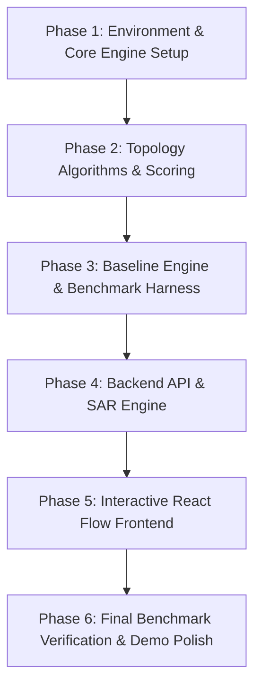

# Hackathon Roadmap & Sprint Plan: GraphSleuth-AML

---

---

### Phase 1: Environment & Synthetic Ground-Truth Data (Completed)
- [x] Initialize Python backend environment with `polars`, `networkx`, `pydantic`.
- [x] Create synthetic benchmark dataset generator with deterministic ground-truth labels for smurfing, cycle loops, and mule chains.
- [x] Establish repository structure: `backend/data` and `backend/graph`.

### Phase 2: Graph Analytics & Typology Detection Engine (Completed)
- [x] Implement temporal graph data structure with fast edge indexing.
- [x] Build Fan-in / Fan-out dispersion detector (smurfing/structuring).
- [x] Build Directed Temporal Cycle detector (round-tripping loops with timestamp monotonicity).
- [x] Build Rapid Pass-Through Mule Chain detector (delta-t velocity and retention ratio).
- [x] Implement composite risk scoring and cluster ranking algorithm.

### Phase 3: Threshold Baseline & Evaluation Benchmark (Completed)
- [x] Implement legacy threshold-based rule engine (CTR >$10k, velocity burst rules).
- [x] Implement evaluation harness reporting Precision, Recall, F1, and False Positive Rate for both systems.
- [x] Verify that GraphSleuth significantly outperforms the baseline on the labeled dataset (+655.9% F1 lift).

### Phase 4: FastAPI Microservice & Explainable SAR Generator (Completed)
- [x] Expose REST endpoints:
  - `POST /api/detect`: Run detection on uploaded or sample dataset.
  - `GET /api/benchmark`: Return comparative metrics (Precision, Recall, F1, confusion matrices).
  - `GET /api/graph/react-flow`: Return nodes and edges formatted for React Flow with subgraph filtering.
  - `GET /api/sar/{id}`: Generate structured FinCEN-compliant Suspicious Activity Report.
- [x] Built and verified with automated test suite in `backend/tests/verify_phase3.py`.

### Phase 5: Interactive Visual Frontend (Next.js + React Flow) (Completed)
- [x] Scaffold React 18 + Tailwind CSS + Lucide Icons + React Flow app.
- [x] Implement React Flow canvas with custom animated nodes and directional edge flows.
- [x] Build Temporal Timeline Scrubber to inspect money flows over time.
- [x] Build Comparative Benchmark Dashboard displaying metrics cards and side-by-side table.
- [x] Build SAR Drawer with 1-click Markdown export.

### Phase 6: Verification, Rehearsal & Pitch Package (Completed)
- [x] Conduct end-to-end integration test with sample datasets (`backend/tests/test_all_e2e.py`).
- [x] Pre-compile production static assets and mount to FastAPI for single-port deployment.
- [x] Deliver single-command platform launcher (`run_system.py`) and documentation (`README.md`).
